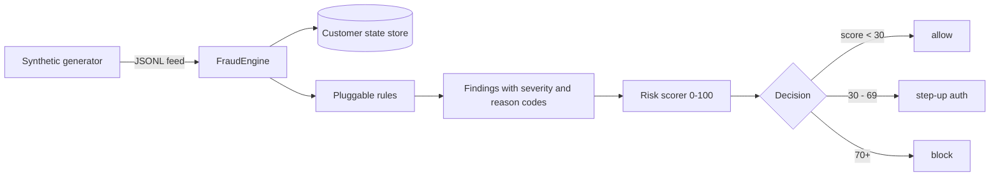

# payment-fraud-detection-lab

A portfolio project built to demonstrate detection engineering for
payments fraud: a working transaction fraud detection engine, a
synthetic data generator, a STRIDE threat model of a cross-border
transfer flow, and an account-takeover incident response runbook.

This is lab code written to show how I think about fraud detection in
fintech. It is not production software and it is not affiliated with
any employer.

## Architecture



The engine keeps a rolling per-sender profile (past transactions, known
devices, payee first-seen times). Each rule reads that state and emits
findings. Findings carry a severity, a stable reason code, and a score
weight. The scorer sums weights, caps at 100, and maps the score to a
decision: allow, step-up-auth, or block.

## Rule catalog

| Rule | Reason code | What it catches | Severity |
|---|---|---|---|
| VelocityRule | VELOCITY_COUNT_EXCEEDED | 5+ transfers from one sender in 10 minutes | high |
| ImpossibleTravelRule | IMPOSSIBLE_TRAVEL | Locations implying travel faster than 1000 km/h | critical |
| NewDeviceRule | NEW_DEVICE_FINGERPRINT | First-seen device fingerprint for the sender | medium |
| AmountAnomalyRule | AMOUNT_ANOMALY | Amount with z-score >= 3 vs sender history | high |
| PayeeChangeRule | PAYEE_CHANGE_THEN_TRANSFER | Transfer >= 500 to a payee added in the last 24h | high |

Rule thresholds are constructor arguments, so tuning is explicit and
testable. Adding a rule means subclassing `Rule` and passing it to
`FraudEngine(rules=[...])`.

## How to run

Requires Python 3.10 or newer.

```bash
pip install -r requirements.txt

# 1. Generate a synthetic transaction feed (seeded, reproducible)
python -m fraudlab.generator --count 2000 --seed 42 --fraud --out transactions.jsonl

# 2. Score the feed end to end
python examples/demo.py --count 3000 --seed 42

# 3. Run the test suite
python -m pytest tests/ -q
```

The generator's `--fraud` flag injects recognizable attack patterns
(velocity bursts, impossible travel, new-device cash-outs, and
payee-change transfers) so the engine has something to catch. Same
seed, same feed, every time.

## Docs

- `docs/threat-model.md`: STRIDE threat model of a cross-border money
  transfer flow (sender auth, FX quote, ledger debit/credit, payout
  rail), with controls mapped per threat.
- `docs/ir-runbook.md`: account-takeover and fraud incident response
  runbook with concrete steps and example detection queries.

## Honest limitations

- Synthetic data only. Real fraud detection lives or dies on feature
  quality and labeled outcomes, and this lab has neither.
- The state store is in memory. A real system needs a feature store
  with strict event-time semantics so rules cannot peek at the future.
- Score weights and thresholds are reasonable starting points, not
  tuned values. Tuning needs labeled data and a precision and recall
  tradeoff owned by the business.
- No sanctions or AML screening, which are regulatory obligations for
  real money transmitters and intentionally out of scope here.
- Single-process and synchronous. Production scoring needs
  millisecond-latency paths and async enrichment.
