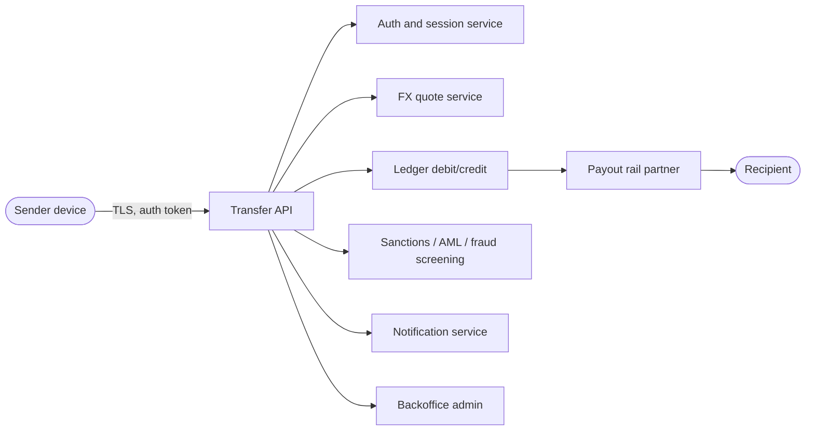

# Threat Model: Cross-Border Money Transfer Flow

A STRIDE threat model of a generic cross-border money transfer service.
This describes an archetypal fintech flow, not any specific company.

## System overview

A sender moves money to a recipient in another country. The flow:

1. **Sender authentication**: login, step-up MFA, session management.
2. **Transfer initiation**: sender picks amount, destination currency, recipient.
3. **FX quote**: the service locks an exchange rate for a short window.
4. **Ledger debit/credit**: the sender's balance is debited; a transfer record is created.
5. **Compliance screening**: sanctions, AML, and fraud rules evaluate the transfer.
6. **Payout rail**: funds leave via bank transfer, mobile money, or cash pickup.
7. **Notifications**: sender and recipient get status updates.

Trust boundaries: client device to API, API to internal services, internal
services to third-party payout partners and FX liquidity providers.

## STRIDE analysis

### S: Spoofing

| Threat | Affected step | Controls |
|---|---|---|
| Credential stuffing or phishing against sender accounts | Sender authentication | MFA enrollment, breached-password screening, rate-limited login, device fingerprinting, anomaly alerts on new device login |
| Session token theft | Sender authentication | Short-lived tokens, binding tokens to device fingerprint, re-auth on sensitive actions (new payee, large amount) |
| Attacker impersonates a payout partner webhook | Payout rail | Mutual TLS, webhook signature verification with rotated secrets, idempotency keys |
| Insider abuse of backoffice admin | Admin | Just-in-time admin access, approval workflows for manual overrides, full audit logging |

### T: Tampering

| Threat | Affected step | Controls |
|---|---|---|
| FX quote manipulation (client replays an expired favorable rate) | FX quote | Server-side quote with short TTL and signed quote ID, re-validate rate at execution time |
| Amount or destination tampering in transit | Transfer initiation | Integrity-checked API payloads, server-side re-derivation of totals, no trust in client-computed fields |
| Ledger double-spend or unbalanced entries | Ledger debit/credit | Double-entry invariants enforced in the database, immutable append-only ledger, reconciliation jobs |
| Webhook payload tampering from payout partner | Payout rail | Signature verification, schema validation, replay protection |

### R: Repudiation

| Threat | Affected step | Controls |
|---|---|---|
| Sender denies authorizing a transfer | Transfer initiation | Tamper-evident audit log of auth events, device and IP capture, step-up auth receipts |
| Disputed payout status with partner | Payout rail | Idempotency keys on every payout call, partner status reconciliation, signed status callbacks |

### I: Information disclosure

| Threat | Affected step | Controls |
|---|---|---|
| PII and balance exposure via API | Transfer API | Field-level access control, minimal data in responses, encryption in transit and at rest, tokenization of account numbers |
| FX pricing or margin leakage | FX quote service | Rate limiting on quote endpoints, no internal spread data in client responses |
| Log leakage of secrets or PII | All | Structured logging with redaction of sensitive fields, log access controls |

### D: Denial of service

| Threat | Affected step | Controls |
|---|---|---|
| Quote endpoint abuse draining FX hedging budget | FX quote | Per-user quote rate limits, quote TTL, hedging limits with alerts |
| Login and transfer API flooding | Sender authentication, Transfer API | Rate limiting, WAF, CAPTCHA on login abuse, autoscaling with cost guardrails |
| Payout partner outage stranding transfers | Payout rail | Multi-rail fallback, queued retries with backoff, clear user-facing status |

### E: Elevation of privilege

| Threat | Affected step | Controls |
|---|---|---|
| Account takeover leading to payee changes and cash-out | Sender authentication, Transfer initiation | New-payee cooling period, step-up auth on payee add and on first transfer to a new payee, velocity and anomaly detection (this lab implements these) |
| API parameter manipulation to access other users' transfers | Transfer API | Object-level authorization checks on every read and write, never trust client-supplied IDs without ownership verification |
| Support tooling used to bypass screening | Backoffice admin | Dual control on screening overrides, alert on override volume spikes |

## Key assumptions

- The lab models the fraud-screening slice of step 5, not the full platform.
- Real deployments add sanctions and AML screening, which are regulatory
  obligations and intentionally out of scope for this detection lab.
- Threat likelihood and impact ratings belong in a live risk register
  owned by the team shipping the product, not in a portfolio writeup.
